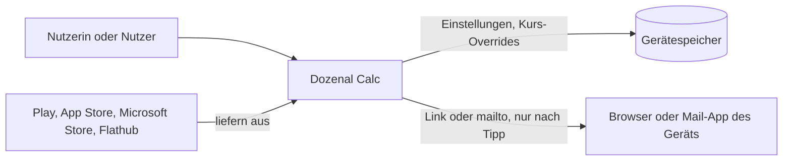
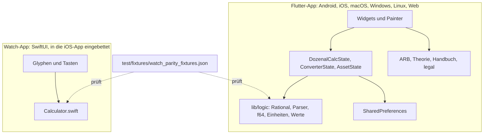

# Architektur

Wissenschaftsrechner, der in Basis 12 rechnet, mit Einheitenrechner, Werterechner und mehrsprachigem Lehrtext.

## Kontext

## Container

Die Schichten nach ARC-02 und ARC-04 entstehen nach ARC-30 bei grösseren Änderungen, nicht in einer Massenaktion.

## Daten

Alle dauerhaften Daten liegen auf dem Gerät in `SharedPreferences`. Es gibt keinen Server und keine Personendaten.

- Darstellung: `theme_mode_v1`, `glyph_style_v1`, `keypad_glyph_style_v1`, `font_size_v1`, `locale_v1`,
  `haptics_enabled_v1`
- Rechner: `keypad_mode_v1`, `keypad_profile_v1`, `numeral_system_v1`, `angle_mode_v1`
- Einführung: `intro_seen_v4`
- Werterechner: eigene Kurse, Metall und Währung je mit eigenem Präfix (`lib/rate_store.dart`)

Speicher, Verlauf und Eingaben der Rechner liegen nur im Arbeitsspeicher.

## Netzziele

Massgebend ist `netz` in `npf.toml`.

| Build | Netzziele | Beleg |
|---|---|---|
| Android, Release | keine | Das Release-Manifest verlangt kein `INTERNET`, nur Debug und Profile (Flutter-Werkzeuge). |
| iOS, macOS, Windows, Linux, watchOS | keine | Der Code öffnet keine Verbindung. Die macOS-Release-Entitlements enthalten nur die Sandbox. |
| Web | keine | CanvasKit und Ersatzschriften liegen auf der eigenen Seite (`web/flutter_bootstrap.js`). Browser-Mitschnitt in acht Sprachen ohne Abruf von Google-Hosts durch die App. |

Der Code in `lib/` nutzt keinen HTTP-Client und kein `Image.network`. Im Web holt `package_info_plus` `version.json` vom
eigenen Host der Seite. Quellen- und Empfehlungslinks öffnet `openExternalLink` nach
einem Tipp im Browser des Geräts. Der Feedback-Dialog öffnet `mailto:`. Die Anfrage stellt jeweils die fremde App, darum
stehen diese Adressen nicht unter `netz`.

Entwicklungswerkzeuge in `tool/` und `android/` (Gradle Play Publisher) laufen nur auf der Arbeitsmaschine. Das gilt auch
für `tool/fetch_web_fonts.py`, das die Schriften beim Bauen von `fonts.gstatic.com` holt.

## Weitere Teile

- [Rendering und Keypad](rendering.md)
- [Info-Modal und Empfehlungen](info-modal.md)
- [Einstellungen und Theming](einstellungen-und-theming.md)
- [Rechner-Seiten](rechner-seiten.md)
- [Intro, Sprachen, RTL](mehrsprachigkeit.md)
- [Android nativ](android-nativ.md)
- [Build und Assets](build-und-assets.md)
- [Distribution](distribution.md)
- [Entwicklung und Tests](entwicklung.md)
- [Konventionen](konventionen.md)

## Projekt

Flutter-Port eines Rust + egui Wissenschafts-Taschenrechners, der nativ in
**Basis 12** (dozenal) rechnet. Ursprung: https://github.com/Bawdyness/dozenal_calc
(Rust-Upstream bleibt unter Bawdyness — bei steinerschueler veröffentlicht
der Autor nur fertige Software, der Rust-Prototyp ist Entwicklungs-Sandbox).
Viele `.dart`-Dateien nennen explizit die Rust-Datei, von der sie portiert
wurden (z. B. `state.dart` ↔ `src/input.rs` + `src/eval.rs`). Bei
Logikänderungen den Kopfkommentar auf das Rust-Gegenstück prüfen — der Port
ist absichtlich 1:1 für die `logic/`- und Dispatch-Schichten.

## Zwei-Schienen-Auswertung (die Kernidee)

Jeder `=`-Druck startet **beide** Auswerter parallel — den exakten
`Rational` (BigInt-basiert) und den `f64`-Auswerter:

- `lib/logic/dozenal_digit.dart` — reine Datenschicht: Enum 0..11 mit
  `value`/`fromValue` (Port von `DozenalDigit` aus `src/logic.rs`). Keine
  Flutter-Imports, wird von Parser, State und Tastenmap geteilt.
- `lib/logic/rational.dart` — exakte Rationals mit Periodenerkennung
  (`1/7` → `0.186A35` mit Überstrich + Punktmarker für den Periodenstart).
- `lib/logic/rat_parser.dart` — Parser der Rational-Schiene. Kollabiert
  bei nicht-rationalen Tokens (sin, log, …), Division durch null und an
  Grössen-Caps: gebrochener Exponent, `^`-Ergebnis > 10M Bits
  (`maxResultBits`), Fakultät > 3000 (`factorialCap` in `rational.dart`).
  Zusätzlich droppt `state.dart` ein bereits berechnetes exaktes Resultat
  > 20000 Bits (`_maxExactRenderBits`) auf f64, weil die
  Digit-Extraktion ~O(n²) ist.
- `lib/logic/expression.dart` — f64-Fallback-Auswerter und
  Ergebnisformatierung. Enthält auch `resolvePostfix`, das vor
  `withImplicitMuls` läuft und postfix-eingegebene Tokens (`n!`, `|x|`,
  `1/x`) in präfix-Funktionsaufrufe umordnet. Standard-Konvention:
  Postfix bindet stärker als unäres Minus, also `−3!` = `−(3!)`. Wenn
  der User `|−3| = 3` will, muss er klammern.
- `lib/logic/result_format.dart` — reine Präsentations-Helfer:
  `resultBufferToString` (Clipboard-Copy/Gleichheits-Check, droppt
  Perioden-Marker), `compactRationalString`/`compactF64String`
  (kompakte Cross-Base-Referenzklammer, 6 Nachkommastellen).

Wenn die Rational-Schiene kollabiert, wird das f64-Resultat als **State B**
mit `≈`-Präfix (links vor dem Ergebnis) angezeigt. Wenn beide
funktionieren, gewinnt die Rational-Schiene.
`DozenalCalcState.isF64Fallback` steuert diese Anzeige.

**Width-Truncation auf der Ergebnis-Zeile:** lange exakte Ergebnisse (z. B.
`AB ⊕ BB` mit Periode-Länge 136 in Basis 12) würden rechts-bündig
gerendert nach links aus dem Display laufen. `_paintResultLine` in
`display.dart` läuft deshalb eine Drop-Schleife: solange `totalW +
suffixW + approxW > rect.width` (ein etwaiges ≈-Präfix zählt mit), wird
das hinterste Token (= niederwertigste
Nachkomma-Stelle) verworfen, Periode-Overlay-Indices werden
mit-geclampt. War vorher kein Suffix gesetzt, wird ein Baseline-`…`
angehängt. Die Semantik ist bewusst getrennt: `≈`-Präfix heisst
approximativ (State B), Baseline-`…` heisst exakt, aber geclippt —
f64-Fallback und Periode können laut Code-Kommentar nie kollidieren.
State C gewinnt visuell über reine Width-Truncation, weil die
Period-Info informativer ist als der reine Schnitt-Marker.

## State (`lib/state.dart`)

`DozenalCalcState extends ChangeNotifier` ist der einzige Orchestrator. Er
besitzt die Input/Result-Buffer, den Speicher, die Modi und `infoState`.
`handleClick(token)` ist der einzige Einstiegspunkt — Tastendrücke und
physische Tastatur-Events laufen beide hierdurch (Tastenmap in
`lib/main.dart`).

**Listen-Mutationen erzeugen frische Instanzen**, weil
`CustomPainter.shouldRepaint` per `listEquals` vergleicht; In-Place-Mutation
bricht die Repaint-Erkennung.

`isArmed(token)` ist die Keypad-Query für den „scharf"-Punkt-Indikator:
sie gibt `true` zurück, wenn ein Tap auf `token` den vorhergehenden
Buffer-Token via `_inverseSwap` in seine Inverse umschalten würde
(z. B. Sin ↔ ArcSin nach erstem Sin-Tap). Anzeige-Logik und Toggle-Logik
müssen über diese gemeinsame Quelle laufen, sonst desynchronisieren sie.
Eingabe von `.` wird zusätzlich durch `_hasDecimalInCurrentLiteral`
gefiltert (beidseitiger Walk durch das aktuelle Zahlen-Literal), damit
`1.2.3`-Eingaben gar nicht erst entstehen.

**Error-Guard mit in-place Edit:** der `handleClick`-Error-Guard ist
dreiteilig:
- **AC** → kompletter Reset (Buffer, Cursor, Error).
- **Mode/Memory/Info-Tokens** (`_isErrorBlocked`: Drg/Doz/Dez/Sto/Rcl/
  Mc/Ans/ConvAns/M+/M−/Info/Expand/Close) → blockiert, User muss AC drücken.
- **Pfeil-Tasten** → Cursor bewegt sich, Error + Input + Cursor bleiben
  erhalten. Lässt den User im fehlerhaften Input navigieren, mit
  Fehlermeldung als Kontext sichtbar.
- **Alle anderen** (Del, Digit, Operatoren, Klammern, Funktionen,
  Equals) → Error löscht sich, Input + Cursor bleiben, dann normaler
  Dispatch. Erlaubt in-place-Editierung des fehlerhaften Ausdrucks
  + Re-Evaluation per Equals, ohne den ganzen Ausdruck neu tippen
  zu müssen.

**Session-History (Tape):** jedes erfolgreiche `=` landet als
`HistoryEntry` (Input + Resultat) in `history` (Cap 30; Dedup nur gegen
den jüngsten Eintrag — wiederholtes `=` stapelt nicht; überlebt AC). UI in `main.dart`: Swipe-down auf dem
Display öffnet ein Bottom-Sheet (`_showHistory`, ARB-Keys
`historyTitle`/`historyEmpty` ×14) mit read-only-Display-Tiles
(`showCursor: false`); Tipp auf einen Eintrag ruft `recallHistory`.
Langdruck auf das Display kopiert das Resultat in die Zwischenablage
(`_copyResult`).

**Startup-Basis:** `DozenalCalcState` selbst startet in Basis 12 (doz),
aber `_applyStartupPrefs` spielt beim Boot den CalcPrefs-Default **Dez**
ein — eine frische Installation rechnet also dezimal, bis der User in
den Einstellungen umschaltet.

## Tokens (`lib/tokens.dart`)

`sealed class CalcToken` mit const-Singleton-Subklassen für
Payload-freie Varianten. Spiegelt das Rust-Enum und erlaubt erschöpfende
`switch`-Pattern-Matches.

## App-Bootstrap (`lib/main.dart`)

Wickelt die vorgenannten Bausteine zusammen — wenn etwas „in main.dart"
liegt, dann hier:

- **System-UI-Setup** (Details siehe Edge-to-edge-Abschnitt): `main()`
  ruft **gar keine** `SystemChrome`-APIs — weder
  `setEnabledSystemUIMode(edgeToEdge)` noch `setSystemUIOverlayStyle(...)`.
  Beide würden über Flutters `PlatformPlugin` laufen, dessen kompilierte
  Methoden statisch auf die deprecated `Window.setStatusBarColor /
  setNavigationBarColor / setNavigationBarDividerColor` referenzieren —
  Play Console scannt das DEX statisch und flaggt diese Referenzen auch
  dann, wenn der Laufzeit-Pfad sie nie erreicht. Edge-to-edge UND
  Icon-Brightness werden ausschliesslich nativ in `MainActivity.java`
  gesetzt (`EdgeToEdge.enable` + `WindowInsetsControllerCompat`).
- **Physische Tastatur:** `_charKeyMap` (zeichen-basiert, inkl. `,` als
  Dezimaltrenner für deutsche Layouts) und `_logicalKeyMap` (Enter,
  Backspace, Pfeiltasten, kompletter Numpad inkl. Fallback-Digits, weil
  Linux bei manchen Layouts `event.character` leerlässt). Beides
  Portierungen aus `src/input.rs::handle_keyboard`. Auf Pager-Seite 0
  mündet alles in `_state.handleClick(token)` — derselbe Pfad wie ein
  Tastendruck; auf Seite 1 (Umrechner) übersetzt `_handleConverterKey`
  in die `ConverterState`-Handler (siehe Einheitenrechner-Abschnitt),
  auf Seite 2 (Werterechner) analog `_handleAssetKey`.
- **Intro-Gate:** `_maybeShowIntro` liest `_kIntroSeenFlag` (aktuell
  `intro_seen_v4`) aus `SharedPreferences` und pusht beim ersten Start
  `IntroPage`; danach wird das Flag gesetzt.
- **Info-Routing:** `_onStateChanged` lauscht auf `state.infoState`,
  resettet es auf `InfoClosed` und pusht `InfoListPage`. Nach
  Navigator-Pop wird der Keyboard-Focus wieder angefordert.
- **State-Ownership:** `DozenalCalcState` und `CalcPrefsNotifier`
  gehören `_DozenalCalcAppState` (oberhalb des Navigators), gereicht
  über `CalcStateScope` + `CalcPrefsScope` sowie per Konstruktor an
  `_CalcScaffold` — der Scaffold lauscht nur, erzeugt/disposed den
  State nicht. Startup: `_calcPrefs.load()` → `_applyStartupPrefs`
  (einmalig Prefs → State); danach spiegelt `_syncPrefsFromState`
  laufend State → Prefs. Details siehe Einstellungen-Abschnitt.
- **Layout-Wurzel:** `_CalcScaffold` ist seit dem Pager-Umbau ein
  horizontaler **PageView** (forciert LTR, auch in RTL-Locales) mit **drei**
  Seiten: Seite 0 rendert `TwoLineDisplay` über `Keypad` (inkl.
  `keypadMode`/`keypadProfile` aus `CalcPrefsScope`), Seite 1 den
  `ConverterBody`, Seite 2 den `AssetBody` (Edelmetalle/Währungen, siehe
  Asset-Rechner-Abschnitt). `displayHeightFor(bodyH)` aus `app_layout.dart`
  bleibt die einzige Grössenrechnung (pro Seite). `_CalcScaffoldState`
  besitzt `ConverterState`, `AssetState` + `PageController` und verdrahtet die
  Resultat-Brücken-Provider aller drei Rechner (Umrechner-Ans/CONV,
  Asset-Ans/VAL inkl. CONV-Tap-Fallback — siehe Resultat-Brücke- und
  Werterechner-Abschnitt).
  (Der frühere `state.converterRequested`-Pfad ist entfernt — der Zugang zu
  den Folgeseiten läuft über Swipe + Page-Peek.)
  Splash-Feedback ist global via `NoSplash.splashFactory` aus, weil die
  Tasten ihre eigene Press-Color-Animation haben.
